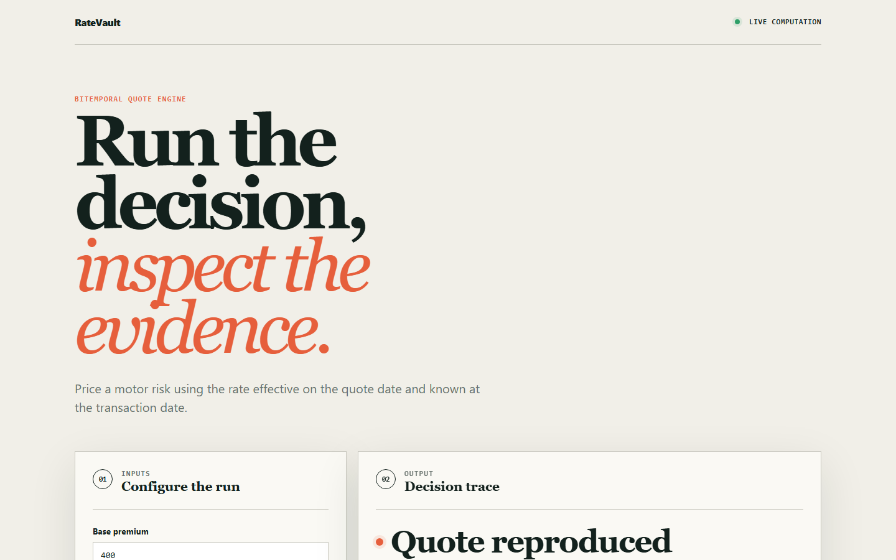
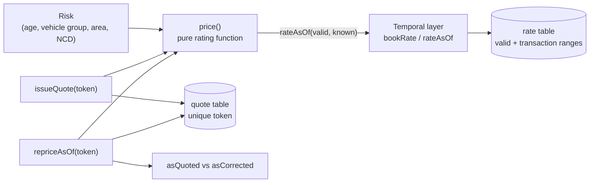

# ratevault

A motor insurance quote engine with bitemporal rate tables, so any past quote can be repriced to the penny.

[](https://github.com/csalekhya/ratevault/actions/workflows/ci.yml)
[Live demo](https://csalekhya.github.io/ratevault/)



## Why

An insurer has to be able to answer, two years later, "why was this customer quoted 1,995.19 on 3 March?" and reproduce the number exactly, using the rates in force that day. Systems that update rate tables in place lose that ability. They also cannot tell apart two different questions: what did we quote, and what should we have quoted once a later, backdated correction is applied. ratevault keeps both answers by storing every rate with two independent time ranges.

## Features

- **Bitemporal rate storage.** Each rate row has a valid-time range (when the rate applied) and a transaction-time range (when the system believed it). Rows are closed, never updated or deleted.
- **Overlap protection in the database.** A trigger rejects overlapping valid-time ranges for the same product, factor and bucket, so a lookup can never have two answers.
- **Deterministic rating pipeline.** `price()` is a pure function of the risk and the rate version. It reads no clock and no global state, and rounds once, at the end.
- **Factor-by-factor explanation.** Every price comes back with the multiplier and running total of each rating factor.
- **Reprice as of both axes.** `repriceAsOf` returns the premium as originally quoted and as corrected by later backdated changes, and flags drift.
- **Idempotent issuance.** `issueQuote` is keyed on a client-supplied token; the same token always returns the same premium.
- **Fail loudly.** A missing rate throws instead of defaulting to 1.0.
- **Browser lab.** A static page in `site/` lets you edit rate rows and inputs and see the computed premium.

## Architecture



`src/temporal.ts` owns the schema and the two-axis lookup. `src/rating.ts` multiplies a base premium by one multiplier per factor (driver age, vehicle group, territory, no-claims years), each fetched with `rateAsOf`. Quotes pin both time axes to the issue time. Repricing replays a stored quote twice: once with transaction time pinned to issue time, once with transaction time set to now. The storage is an in-memory SQLite database (`node:sqlite`); the triggers play the role a PostgreSQL `tstzrange` GiST exclusion constraint would play in production.

## Quick start

Prerequisites: Node.js 22.18+ (24 recommended). TypeScript runs through Node's built-in type stripping, so there is no build step and no dependencies to install.

```bash
git clone https://github.com/csalekhya/ratevault.git
cd ratevault
npm test        # run the test suite
npm run demo    # backdated-correction walkthrough
```

## Example

`npm run demo` quotes a 22-year-old, then books a backdated correction to the young-driver loading:

```
  3 March: quoted GBP 1995.19 to a 22-year-old, group 35,
           area N, no claims history.

  How that premium was built:
    base                              400.00
    DRIVER_AGE   AGE_17_24      x1.85   740.00
    VEHICLE      VEH_31_50      x1.70   1258.00
    TERRITORY    AREA_N         x1.22   1534.76
    NCD          NCD_0          x1.30   1995.19

  Two questions, two answers:
    "what DID we quote?"            GBP 1995.19   <- unchanged, and provable
    "what SHOULD we have quoted?"   GBP 1671.64   <- owed back: GBP 323.55
```

## How it works

- **Two axes, two lookups.** `rateAsOf(db, product, factor, bucket, validAt, knownAt)` selects the row whose valid range contains `validAt` and whose transaction range contains `knownAt`. Both arguments are required; defaulting either one is how the two questions get conflated.
- **Corrections are new beliefs.** `bookRate` closes the transaction range of any currently believed overlapping row, then inserts the new row. What the system used to believe stays queryable.
- **Why the overlap trigger.** Two overlapping valid ranges would make the lookup depend on row order, which quietly breaks determinism.
- **Rounding.** Premiums are rounded to the penny once, after the last factor.

See [docs/ARCHITECTURE.md](docs/ARCHITECTURE.md) for decisions, failure modes and scope.

## Testing

```bash
npm test
```

Twelve tests run in CI on Node 24:

- Replay of 20,000 generated quotes spread over 24 months; every premium must reproduce exactly.
- Purity: identical inputs give identical outputs. Missing rates throw. Issuance is idempotent on the token.
- A backdated correction changes the "should have quoted" answer while leaving "what we quoted" untouched, and the superseded belief stays queryable.
- Overlapping valid ranges are rejected; adjacent ranges and empty ranges behave correctly.
- Two tests for the browser lab (`site/core.test.mjs`).

## Project layout

```
src/temporal.ts        schema, bookRate, rateAsOf
src/rating.ts          price, issueQuote, repriceAsOf, seedRates
src/demo.ts            runnable walkthrough
tests/                 reproducibility and temporal tests
site/                  browser lab (deployed to GitHub Pages)
docs/                  architecture notes and screenshots
```

## Limitations

- Not an actuarial model: the rating maths is intentionally simple and the rate table is synthetic.
- Storage is in-memory SQLite. There is no HTTP API, PostgreSQL backend or persistence.
- The browser lab uses a simplified calculation of its own and does not call the engine in `src/`.

## License

MIT, see [LICENSE](LICENSE).

## Maintainer

Originally authored by Sai Alekhya Chandramouli, this project is currently maintained by Sai Alekhya Chandramouli, Business Intelligence Analyst & Developer.

[GitHub project](https://github.com/csalekhya/ratevault) · [LinkedIn](https://www.linkedin.com/in/alekhya-chandramouli/) · [Email](mailto:alekhiya.chandramouli@gmail.com)