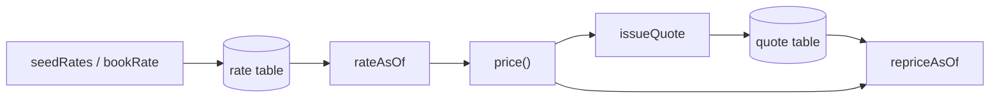

# Architecture

## Context

Insurers must be able to explain and reproduce any historical quote. Rates change over time, and some changes are corrections applied retroactively. ratevault is a small engine that keeps rate history in a form that answers both "what did we quote" and "what should we have quoted".

## Container view

Everything runs in one process against an in-memory SQLite database created by `createDatabase()`.

## Key decisions

- **Bitemporal rows instead of an effective date.** Valid time and transaction time are separate columns. A single effective date cannot distinguish a backdated correction from the original pricing. Trade-off: every lookup takes two time arguments and corrections add rows instead of editing them.
- **Pure rating function.** `price()` takes the database, risk and both timestamps as arguments and reads no clock. Trade-off: callers must supply time explicitly.
- **Overlap trigger.** Within currently believed rows, overlapping valid ranges for one key are rejected. This mirrors a PostgreSQL GiST exclusion constraint, implemented with a trigger so the project runs with no install.
- **Hard failure on missing rates.** A hole in the rate table raises an error rather than defaulting to a multiplier of 1.0.
- **Idempotent issuance.** A unique token column plus a read-before-write check makes repeated issuance return the original premium.

## Failure modes

- Missing rate for a factor and bucket: `price()` throws with the product, factor, bucket and both timestamps.
- Overlapping valid ranges: the insert is aborted by the trigger.
- Empty ranges: rejected by `CHECK` constraints.

## Out of scope

- Actuarial accuracy of the factors.
- Persistence, HTTP API and a PostgreSQL backend.
- Rate staging and portfolio impact simulation.
